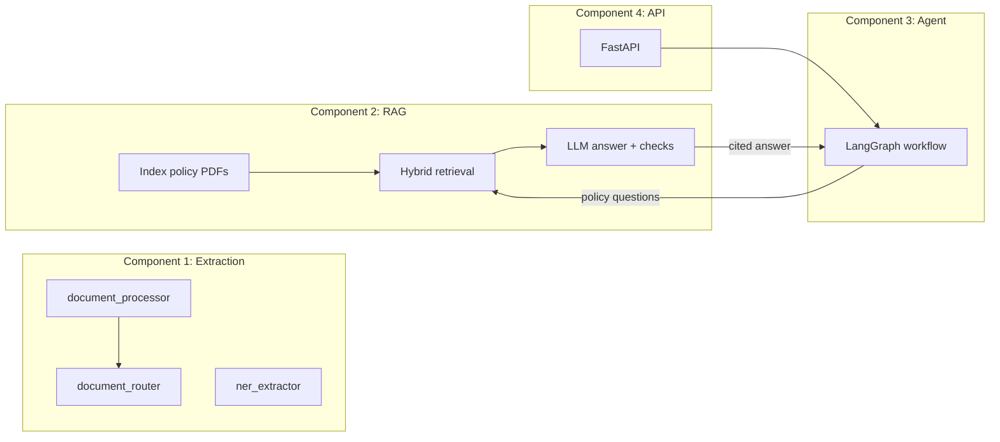

# Financial Document Intelligence System

A Python project that processes financial documents, answers questions about company policy with cited sources, and investigates vendor payments for compliance issues. Everything is exposed through a FastAPI service.

The project has four components:

| # | Component | Folder | What it does |
|---|-----------|--------|--------------|
| 1 | Document extraction | `src/component1_extraction` | Detects file format, extracts text, tags entities in bank narrations (NER), and routes documents by type |
| 2 | RAG pipeline | `src/component2_rag` | Indexes policy PDFs and answers questions with citations and a faithfulness check |
| 3 | Research agent | `src/component3_agent` | Investigates a vendor's transactions against policy limits, scores risk, and writes an audit trail |
| 4 | API | `src/component4_api` | FastAPI service with request IDs, error handling, and basic metrics |

Shared code (settings, custom exceptions, data classes) lives in `src/common`.

---

## Architecture



**Current wiring:** `API → Agent → RAG` is connected and works end to end. Component 1 is built and tested on its own but is not yet called from the API (see [Known limitations](#known-limitations)).

### Component 1: Extraction

- **`document_processor.py`**: Identifies the real file type from the file's bytes (not the extension), then extracts text from PDFs (native text or OCR for scans), `.xlsx` files, and plain text. Enforces a 50 MB size limit and raises specific errors for corrupted or unsupported files.
- **`ner_extractor.py`**: Uses a fine-tuned DeBERTa-v3 model to tag bank narration text with `ORG`, `AMOUNT`, `DATE`, `REF`, and `METHOD`.
- **`document_router.py`**: Takes extracted text, checks for duplicates, classifies the document type, and decides what to do based on confidence:

  | Confidence | Outcome |
  |------------|---------|
  | above 0.85 | Auto-routed |
  | 0.50 to 0.85 | Routed, flagged for human review |
  | below 0.50 | Rejected to a dead-letter queue |

### Component 2: RAG

```
PDF → section extraction → parent/child chunks
    → vector search + BM25 search → Reciprocal Rank Fusion (top 10)
    → cross-encoder rerank (top 3) → Ollama LLM
    → sufficiency check + faithfulness check → answer with citations
```

- Parent/child chunking: small child chunks are searched, larger parent sections give context.
- Hybrid retrieval (semantic + keyword) catches both meaning matches and exact terms like policy codes.
- Answers below the faithfulness threshold (default 0.85) are rejected rather than returned.
- LLM calls retry up to 3 times with exponential backoff.

### Component 3: Agent

A LangGraph workflow with these steps:

```
extract_vendor_info → fetch_transactions → retrieve_policies
    → analyse_compliance → check_escalation_required
         ├─ escalation    → create_escalation_alert
         ├─ summary       → generate_summary
         └─ clarification → end
```

It matches the vendor name (fuzzy match), pulls transactions, asks the RAG pipeline about relevant policy, flags violations, assigns a risk level, and escalates high-risk cases. Every run is written to an audit log under `data/audit/`.

### Component 4: API

| Method | Endpoint | Description |
|--------|----------|-------------|
| `GET` | `/health` | Service status and version |
| `GET` | `/metrics` | Request, error, and latency counters (JSON) |
| `POST` | `/api/v1/research` | Run the vendor compliance investigation |
| `GET` | `/api/v1/audits/{query_id}` | Fetch a saved audit record |

Every response carries an `X-Request-ID` header, and unhandled errors return structured JSON instead of a stack trace.

---

## Project structure

```
.
├── src/
│   ├── common/                  # config, exceptions, shared data classes
│   ├── component1_extraction/   # processor, NER, router, labeled dataset
│   ├── component2_rag/          # RAG pipeline and evaluator
│   ├── component3_agent/        # research agent, resilience, audit logger
│   └── component4_api/          # FastAPI app, middleware, monitoring
├── notebooks/ner_training.ipynb # fine-tunes the NER model (run once, manually)
├── tests/                       # pytest suite
├── outputs/                     # evaluation results and sample agent run
├── Dockerfile
├── docker-compose.yml
└── requirements.txt
```

---

## Getting started

### Prerequisites

- **Python 3.12** (recommended). Python 3.14 is too new for several dependencies such as `torch`, `sentencepiece`, and `transformers`.
- **Ollama**, only needed for real RAG/agent requests: https://ollama.com
- **Tesseract OCR**, only needed for scanned PDFs: https://github.com/tesseract-ocr/tesseract

### Install

```bash
git clone <your-repo-url>
cd <repo-folder>

python -m venv .venv

# Windows (Command Prompt)
.venv\Scripts\activate.bat
# Windows (PowerShell)
.venv\Scripts\Activate.ps1
# macOS / Linux
source .venv/bin/activate

python -m pip install --upgrade pip
python -m pip install -r requirements.txt
```

> Use `python -m pip` rather than bare `pip` to make sure packages go into the active environment.

### Configure

Settings are read from `.env` (every value has a default in `src/common/config.py`):

```
OLLAMA_BASE_URL=http://localhost:11434
OLLAMA_MODEL=llama3.2:3b
EMBEDDING_MODEL=sentence-transformers/all-MiniLM-L6-v2
RERANKER_MODEL=cross-encoder/ms-marco-MiniLM-L-6-v2
TOP_K_RETRIEVAL=10
TOP_K_GENERATION=3
RRF_K=60
FAITHFULNESS_THRESHOLD=0.85
```

Do not put secrets or API keys in this file if you commit it.

### Start Ollama (for real RAG/agent calls)

```bash
ollama serve
ollama pull llama3.2:3b
```

### Run the API

```bash
python -m uvicorn src.component4_api.main:app --reload
```

Interactive docs: http://127.0.0.1:8000/docs

Example request:

```bash
curl -X POST http://127.0.0.1:8000/api/v1/research \
  -H "Content-Type: application/json" \
  -d '{
    "vendor_name": "Sharma Raj Trading",
    "analyst_id": "analyst-001",
    "start_date": "2026-01-01",
    "end_date": "2026-12-31"
  }'
```

### Run with Docker

```bash
docker compose up --build
```

The API is served on port 8000 and the container reports healthy once `/health` responds. Ollama runs on the host, so point `OLLAMA_BASE_URL` at it (for example `http://host.docker.internal:11434`).

---

## Tests

```bash
python -m pytest tests/ -q
```

The suite covers document routing, NER post-processing, RAG fusion, the agent workflow, degradation helpers, and the API. LLM and model calls are replaced with fakes, so tests run without Ollama or trained weights (the first run is slower because PyTorch has to load).

---

## Training the NER model

The extractor needs a fine-tuned model in `./financial-ner-model`. This folder is not in the repo, so you must create it once.

1. Open `notebooks/ner_training.ipynb` in VS Code or Jupyter and select the project's `.venv` as the kernel.
2. Make sure `DATA_FILE` points to `src/component1_extraction/transactions_labeled.jsonl` (500 labeled examples).
3. Run all cells. This downloads `microsoft/deberta-v3-base` (~500 MB) and trains for 5 epochs. Expect it to be slow on CPU.
4. The model and tokenizer are saved to `./financial-ner-model`.

If the tokenizer fails to load, install `sentencepiece`, `protobuf`, and `tiktoken`, then restart the kernel.

Results are written to `outputs/eval_results.json` by the last cell of the notebook.

## Evaluating the RAG pipeline

1. Put your policy PDFs in `corpus/`.
2. Create `data/rag_evaluation.json` with question and expected-answer pairs.
3. With Ollama running, index the corpus and run the evaluator:

```bash
python -c "from src.component2_rag.rag_pipeline import FinancialRAGPipeline; FinancialRAGPipeline().index_documents('corpus')"
python -m src.component2_rag.rag_evaluator
```

The report is saved to `outputs/rag_eval_report.json`.

---

## Design decisions

- **Fine-tuned DeBERTa for NER** instead of regex or prompting an LLM. Bank narrations are short and messy, and a fine-tuned token classifier is fast, runs offline, and gives span-level output that can be evaluated with F1.
- **BIO tagging with character offsets mapped to tokens**, so labels written against raw text work with sub-word tokenizers.
- **Hybrid retrieval (vector + BM25) fused with RRF**, then cross-encoder reranking. Semantic search handles paraphrases; BM25 handles exact identifiers and thresholds.
- **Parent/child chunks.** Precise matching on small chunks, with the larger section returned for context.
- **Faithfulness gate.** The system prefers to say it cannot answer rather than return an unsupported answer.
- **File type detection by content signature**, so a renamed file cannot slip past validation.
- **Confidence-tiered routing** so only clear-cut documents are fully automated; ambiguous ones go to a person.
- **LangGraph for the agent**, because the investigation has branching (escalate, summarise, or ask for clarification) that is easier to reason about as an explicit graph.
- **Dependency injection** for the router and agent (classifier, RAG pipeline, audit logger are passed in), which keeps them easy to test with fakes.

## Assumptions

- Documents are in English, and transaction narrations follow Indian banking formats (NEFT, RTGS, cheque, and similar).
- Ollama is available locally for any request that needs an LLM.
- Policy documents are text-based PDFs placed in `corpus/`.
- Only `.xlsx` is supported for spreadsheets (legacy `.xls` is rejected).

---

## Known limitations

These are real gaps in the current code, listed so nobody is surprised:

1. **Component 1 is not connected to the API.** There is no `/documents/ingest` endpoint, and nothing outside Component 1 calls `document_processor`, `document_router`, or `ner_extractor`.
2. **Two different `ExtractionResult` and `DocumentType` definitions exist** (one in `src/common/models.py`, one in `document_router.py`). The processor and router cannot yet pass data to each other.
3. **`DocumentClassifier` needs a trained scikit-learn model** loaded with `joblib`, and there is no training script for it in the repo.
4. **The NER model is not included.** Run the notebook to create it.
5. **There is no `/rag/query` endpoint**, so the RAG pipeline is only reachable through the agent.
6. **`/api/v1/research` is synchronous.** A job queue with polling would be better for slow LLM calls.
7. **No authentication or rate limiting** on any endpoint.
8. **`/metrics` returns JSON**, not Prometheus text format.
9. **The circuit breaker is not implemented.** `resilience.py` only does retry with linear backoff, and the agent does not call it. The RAG pipeline has its own retry for Ollama calls.
10. **The deduplication store is in memory** and resets on restart.
11. **Test gaps:** agent tests cover only two happy paths, and degradation tests exercise the retry helper rather than the agent's failure scenarios.

## Roadmap

- Wire Component 1 into the API (`POST /documents/ingest` with size and format validation)
- Merge the duplicate data classes into `src/common/models.py`
- Add a training script for the document classifier
- Implement a real circuit breaker and use it in the agent
- Async job pattern for research requests (`job_id` + polling endpoint)
- Bearer-token auth and per-user rate limiting
- Prometheus-format metrics and a persistent dedup store
- Broader agent tests for each failure path

---

## Troubleshooting

| Problem | Fix |
|---------|-----|
| `pip` is not recognized | Use `python -m pip ...` |
| `No module named pip` | Run `python -m ensurepip --upgrade` |
| Packages fail to install on Python 3.14 | Create the venv with Python 3.12: `py -3.12 -m venv .venv` |
| Notebook cannot find the dataset | Point `DATA_FILE` at the full or relative path of `transactions_labeled.jsonl` |
| `Trainer` rejects `tokenizer=` | Newer `transformers` renamed it to `processing_class=` |
| Connection error to Ollama | Check `ollama serve` is running and `OLLAMA_BASE_URL` is correct |
